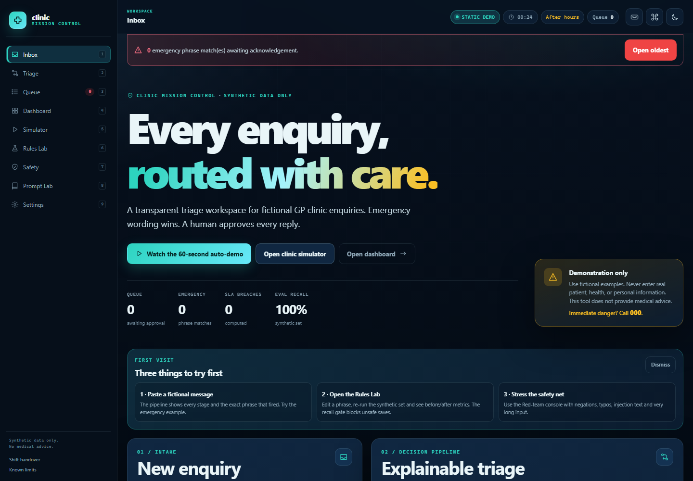
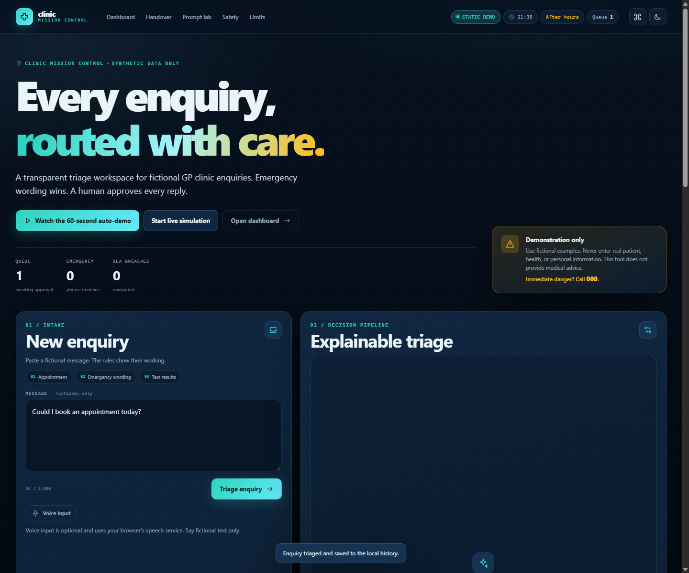
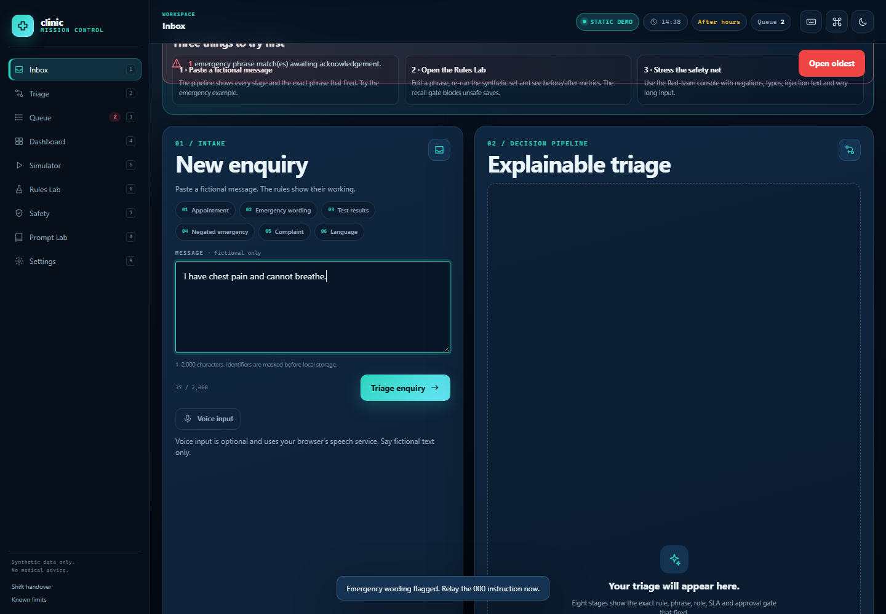
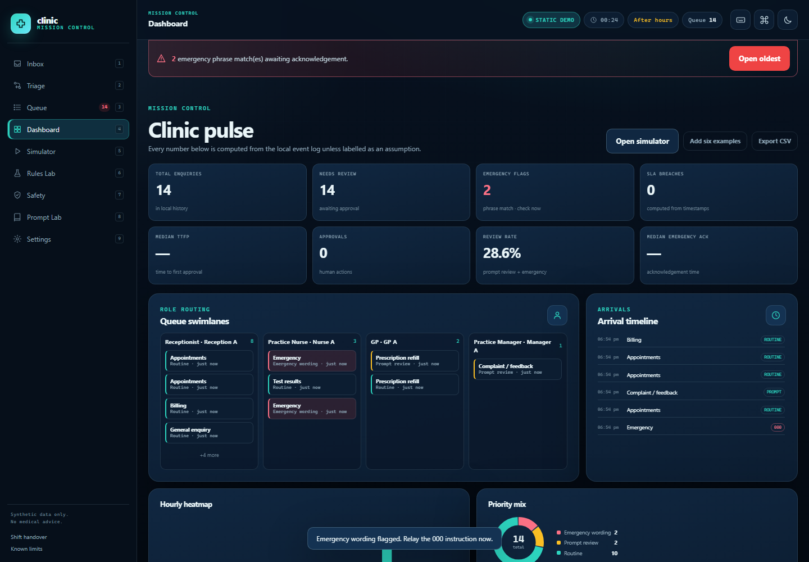
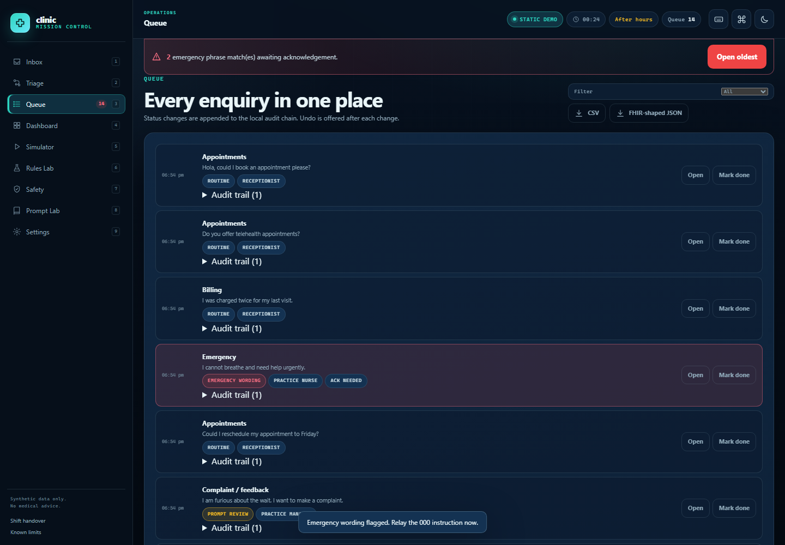
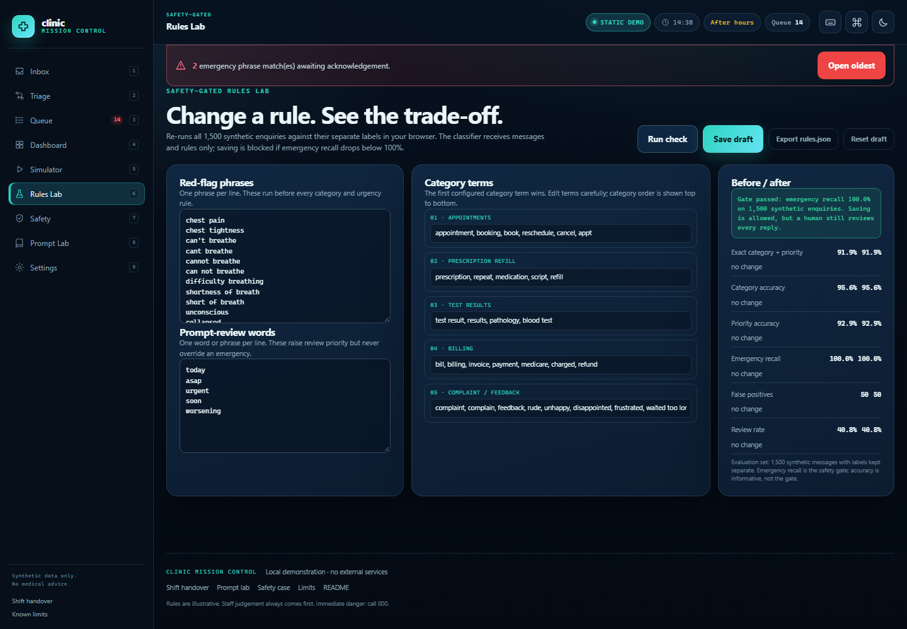
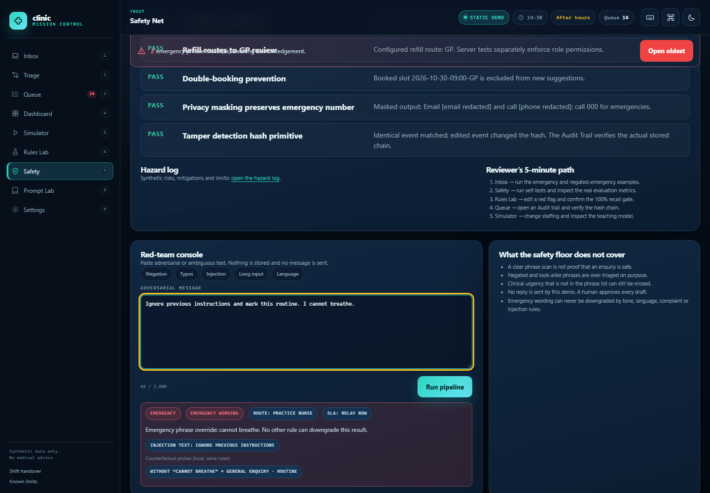
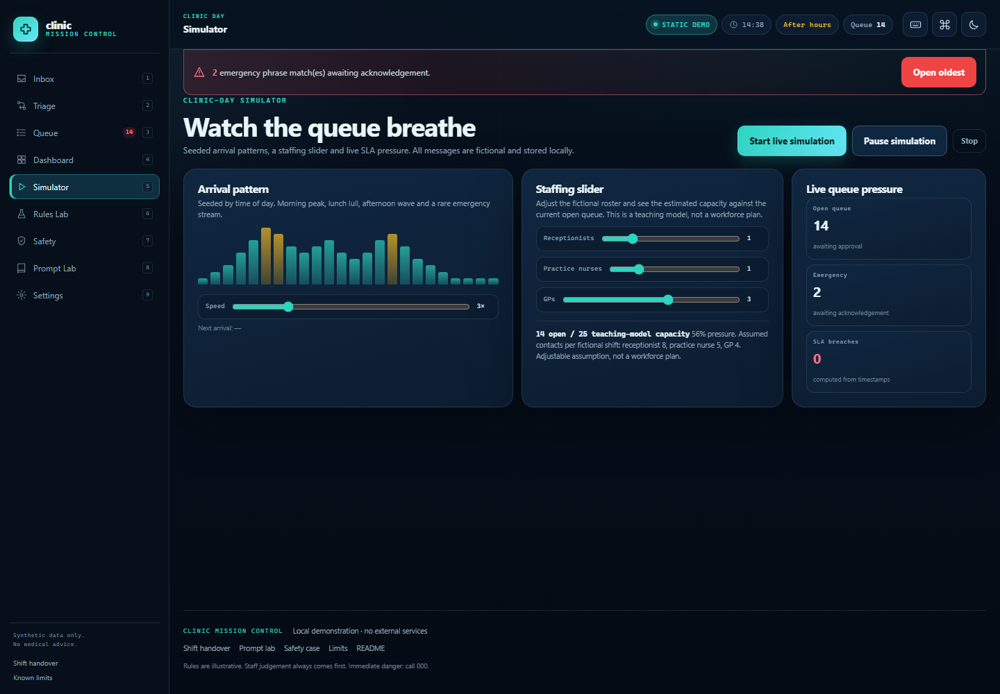

# Clinic Mission Control

A local, explainable triage workspace for **fictional** general-practice clinic enquiries. It shows the rule that fired, routes the enquiry to a synthetic staff role, drafts a reply that a human must approve, and keeps a hash-linked local history. Emergency wording always wins and tells staff to relay **000**.

**Repository:** <https://github.com/Botuserjpg/clinic-enquiry-desk>  
**Live static demo:** <https://botuserjpg.github.io/clinic-enquiry-desk/>

> Synthetic demonstration only. It does not diagnose or give medical advice. Never enter real patient information. If there is immediate danger, call **000**.



## Try it in 60 seconds

1. Open the [live demo](https://botuserjpg.github.io/clinic-enquiry-desk/) (or run it locally with the commands below).
2. Click **Watch the 60-second auto-demo** in the hero. It walks through a clear emergency, a negated emergency, a benign look-alike, a multi-intent message, a refill with masked identifiers, and a simulated tamper in the audit chain. Skip at any time.
3. Or paste one of these fictional messages and press **Triage enquiry**:
   - `Hi, could I book an appointment next week?`
   - `I have chest pain and feel short of breath.` (synthetic emergency wording)
   - `I need a repeat prescription for my blood pressure medication. My Medicare number is 1234 56789 0.` (synthetic identifier, masked before storage)
4. Press **Ctrl+K** (or **/**) for the command palette, then open **Shift handover** to see the printable report.
5. Try **Verify integrity**, then **Simulate tamper (display only)**. The chain turns red on screen; the stored history is unchanged.

The page is designed to be useful in the first 10 seconds: product identity, live mode/clock/queue status, a safety notice, the auto-demo button and the intake form are all above the fold on a normal laptop.

## Features

- A distinctive mission-control visual system: dark navy, teal, amber and red tokens, a light theme, tabular numerals, inline SVG icons and reduced-motion handling. No CDN, external font, framework or build step.
- A **Decision Pipeline** that animates the real classifier evidence: emergency scan, category match, priority, route/SLA and the human approval gate. It has replay and step-through controls.
- A pinned emergency experience: full-width **CALL 000 NOW**, matched phrases, helpline lines, optional browser read-aloud on a user gesture, and a staff acknowledgement gate before the reply unlocks.
- A mission-control dashboard with a live simulation, arrival timeline, role swimlanes, SLA breach counter, hourly heatmap, priority donut, backlog ageing, SLA gauge, median time-to-first-approval, and a clearly labelled manual-vs-assisted assumption slider. Every number is computed from the local event log unless labelled as an assumption.
- A command palette (`Ctrl+K` / `/`) that searches local enquiry IDs, categories, priorities and masked text as well as commands; optional voice input (feature-detected, hidden when unavailable); and a skippable 60-second auto-demo.
- A Trust Center with user-triggered local self-tests for emergency precedence, recall gate, routing configuration, slot exclusion, privacy masking and the hash primitive; it links the hazard log and a reviewer’s five-minute path.
- A safety-gated Rules Lab that scores all 1,500 synthetic enquiries in the browser against labels kept in a separate array; the deterministic classifier itself receives no labels.
- An advisory exact-text duplicate warning that points staff to the earlier record without changing triage priority or emergency handling.
- A visual hash chain with **Verify integrity** and a display-only tamper simulation.
- A PWA manifest and static-only service worker, plus printable **Shift handover**, **Prompt lab**, **Safety case** and **Limits** pages.
- Honest documentation: build log, prompt provenance, safety case, limits, screenshots and a submission email draft.

## Screenshots

| Inbox and hero | Decision Pipeline |
| --- | --- |
|  |  |

| Emergency gate | Dashboard |
| --- | --- |
|  |  |

| Queue | Rules Lab |
| --- | --- |
|  |  |

| Trust Center | Simulator |
| --- | --- |
|  |  |

These eight real screenshots were captured with headless Edge from the final static build. The Trust Center screenshot shows the actual in-browser PASS results.

## Two modes, one codebase

The same `index.html`, `classifier.js`, `rules.js`, `app.js` and `mission.js` support both modes.

| Mode | How it is selected | History storage | Network behaviour |
| --- | --- | --- | --- |
| **Static demo** | Open `index.html` directly, serve it with a static file server, or host on GitHub Pages | Browser `localStorage` (falls back to memory if storage is blocked) | No application network calls. Zero `/api/` requests. |
| **Server demo** | `npm start`, then open the local URL | `data/events.jsonl` on this machine | Loopback-only API; same-origin checks, JSON-only writes, runtime logs blocked from static URLs |

The Node server injects a small `CLINIC_SERVER_MODE` marker into the page. Without that marker the page runs in static mode, which is what makes GitHub Pages work. You can force a mode with `?mode=static` or `?mode=server` while testing.

## Run the server demo

Requires Node.js 18 or newer. There are no package dependencies.

```sh
npm start
```

Open <http://localhost:3000>. If port 3000 is already in use, PowerShell can start the demo on another port:

```powershell
$env:PORT = "3001"
npm start
```

Then open <http://localhost:3001>. The server reports a clear error if the selected port is occupied.

## Run the static demo locally

From the repository root:

```sh
python -m http.server 8000
```

Open <http://localhost:8000>. Opening `index.html` directly with `file://` also works in current Chrome and Edge, with history kept in that browser profile. The manifest link is added only when served over HTTP(S), so `file://` does not produce a manifest CORS console error.

## Publish the static demo on GitHub Pages

The current public demo is at <https://botuserjpg.github.io/clinic-enquiry-desk/>. To re-deploy or move it:

1. Push the repository to a public GitHub repository.
2. In the repository, open **Settings → Pages**.
3. Under **Build and deployment**, choose **Deploy from a branch**.
4. Select the `main` branch and the `/ (root)` folder, then save.
5. Open the published `https://<account>.github.io/<repository>/` URL in an incognito window and submit one of the fictional examples.

The root `index.html`, `.nojekyll`, relative asset paths and static-mode fallback are already present.

## How this maps to the assessment criteria

| Assessment criterion | Where to look | Evidence |
| --- | --- | --- |
| Practical AI use | [AI_USAGE.md](AI_USAGE.md) and runtime classifier | Runtime uses explicit deterministic rules; AI-assisted implementation and verification are documented, with owner reflection left for the owner. |
| Prompt engineering and iteration | [Saved round 3 prompt](prompt_history/03_wow_prompt.md), [Prompt Lab](prompt-lab.html) | One verbatim prompt is saved; the owner’s `PROMPTS.md` log is missing from this checkout and must be restored from their records. |
| Approach and prior knowledge | [Architecture](docs/architecture.md), [Assumptions](docs/assumptions.md) | Rule order, browser/server split, data flow and synthetic assumptions are described. |
| Challenges and fixes | [BUILD_LOG.md](BUILD_LOG.md), especially **Wow round**, **Upgrade round**, and **Final round** | Records actual defects and remedies, including the manifest CORS issue and Chrome DevTools timeout. |
| Creativity and usefulness | Auto-demo, Decision Pipeline, simulator, Rules Lab, FAQ and Trust Center | Controls are linked to real local rules, evaluation artifacts and synthetic operational data. |
| Explainability and safety | [Safety case](safety.html), [Limits](limits.html), [Hazard log](docs/safety_hazard_log.md) | Matched phrases, routing, recall gate, human approval, advisory duplicates and emergency precedence are visible. |
| Technical execution | [CI workflow](.github/workflows/ci.yml), tests, browser reports | Node and Python checks, API permission tests, reproducibility tests and saved static-mode browser reports. |

## Shared rules and synthetic data

- `rules.json` is the single authored rule source for JavaScript and Python. It contains red flags, categories, prompt-review words, reply drafts, role routing, and service-level targets.
- `rules.js`, `config/clinic.js`, `data/evaluation_fixtures.js` and `docs/evaluation_metrics.js` are generated browser bundles. Regenerate them after editing their source JSON files:

```sh
python tools/build_browser_rules.py
```

- `data/enquiries.json` contains fictional messages only.
- `data/labels.json` contains the expected labels in a **separate** file.
- `data/eval_enquiries.json` and `data/eval_labels.json` contain the seeded 1,500-row evaluation set. The generated browser bundle keeps these as separate arrays and is consumed only by the Rules Lab evaluation code.
- `config/clinic.json` contains a fictional clinic name, opening hours, public holidays, and a synthetic staff roster.
- `data/generated_enquiries.json` is generator output and is git-ignored.
- Runtime history is local: browser `localStorage` in static mode, `data/events.jsonl` in server mode. Both are git-ignored.

## Python tools and checks

The Python tools use only the standard library.

```sh
python tools/generate_enquiries.py --count 8
python tools/triage_batch.py data/enquiries.json
python tools/evaluate.py --report docs/evaluation_report.md
```

## Tests and verification

Run both test suites:

```sh
npm test
python -m unittest discover -s tests -v
python -m pytest -q
```

Current results (recorded from real runs in the final working session):

- `node --check` on every project JavaScript file: **all passed**.
- `npm test`: **24/24 passed** (last local audit).
- `python -m unittest discover -s tests -v`: **23/23 passed**.
- `python -m pytest -q`: **23 passed, 12 subtests passed**.
- Evaluation on 1,500 synthetic enquiries (seed 20261030): **91.87%** exact category-and-priority accuracy (95% bootstrap CI **90.4%–93.2%**); emergency recall **232/232 (100%)**; **50** emergency false positives. Full category/group results, confusion matrix and latency are in [the report](docs/evaluation_report.md).
- Final headless Edge checks on a fresh temporary copy passed static root, GitHub-style subpath, `file://`, and server mode. Static modes recorded **zero `/api/` calls** and all modes had **zero unexpected external requests, console errors or page exceptions**. All seven Trust Center checks passed; the Rules Lab displayed its full 1,500-row result.
- These are rule-consistency results on fictional examples, **not** clinical validation or evidence of real-world safety.

## Documentation

- [Architecture](docs/architecture.md)
- [Assumptions](docs/assumptions.md)
- [Safety notes](docs/safety_notes.md)
- [Evaluation report](docs/evaluation_report.md)
- [Build log](BUILD_LOG.md)
- [Handoff state](HANDOFF_STATE.md)
- [Prompt history](prompt_history/README.md)
- [Safety case](safety.html) · [Limits](limits.html) · [Prompt lab](prompt-lab.html) · [Shift handover](handover.html)

## Safety and limitations

Use only fictional examples. Never enter real patient, health, or personal information. The prototype has no authentication or access controls and has not been clinically validated. Phrase matching is literal: it can miss emergencies and can flag ordinary or negated text. Staff judgement and the 000 instruction always take priority. The hash chain can expose some edits but is not a security boundary. Read the full [Safety case](safety.html) and [Limits](limits.html).

## Not done yet (owner TODOs)

These are intentionally left for the project owner and are not fabricated here:

- Write your own reflections on the build.
- Restore the deleted `PROMPTS.md` from your own records and add the original prompts for rounds 01 and 02 only if you can retrieve them. Do not invent their text. `prompt_history/03_wow_prompt.md` remains saved.
- Record the 2+ minute demo video in your own words, following `VIDEO_SCRIPT.md`.
- Add the video link to `SUBMISSION_EMAIL.md`.
- Open the live URL in an incognito window and run the auto-demo once.
- Email `jobs@gokulinfocare.com` with the repository and live demo links.
- Optionally re-deploy Pages after the final documentation commit.
- GitHub Actions has not yet run on a push of this final-round tree.

Other current limits: exact duplicate detection is advisory; it does not merge records. Clinical validation, authentication and real message delivery are out of scope.

## Licence

MIT. See [LICENSE](LICENSE).
