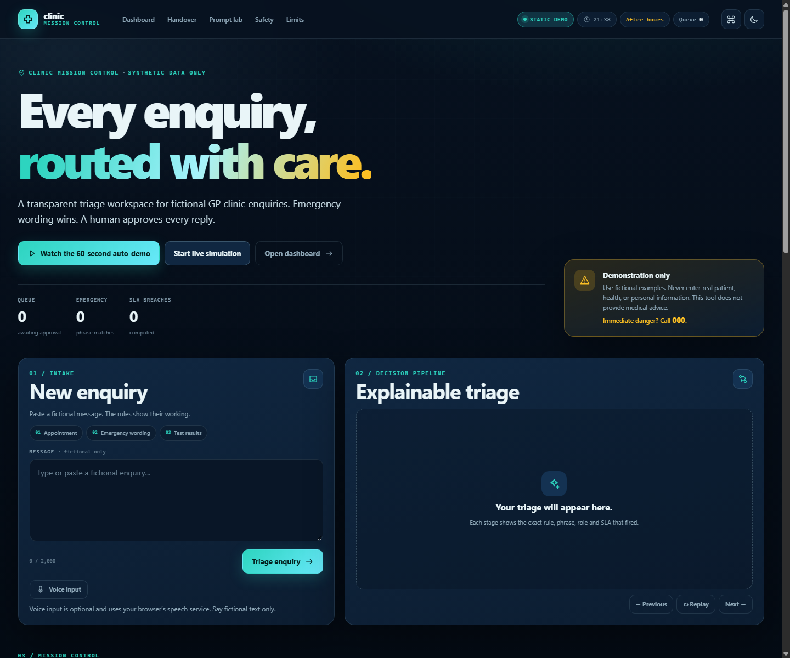
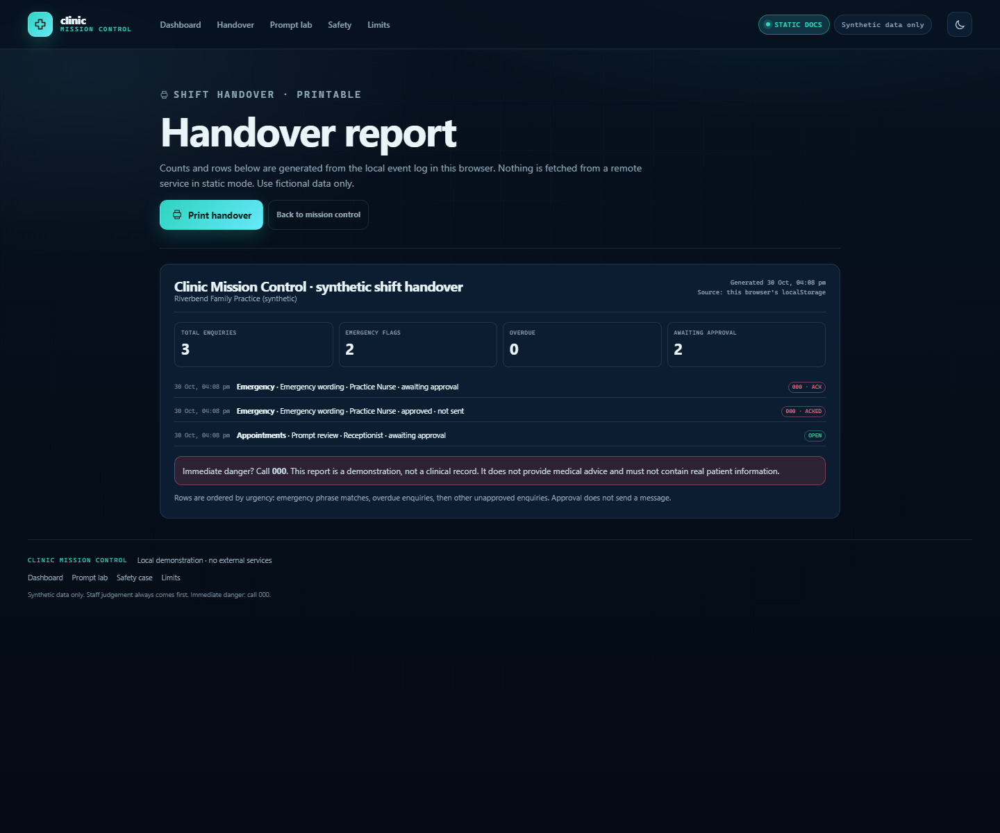

# Clinic Mission Control

A local, explainable triage workspace for **fictional** general-practice clinic enquiries. It shows the rule that fired, routes the enquiry to a synthetic staff role, drafts a reply that a human must approve, and keeps a hash-linked local history. Emergency wording always wins and tells staff to relay **000**.

**Repository:** <https://github.com/Botuserjpg/clinic-enquiry-desk>  
**Live static demo:** <https://botuserjpg.github.io/clinic-enquiry-desk/>

> Demonstration only. This is **not** a medical device, does not diagnose, does not give medical advice, and must not be used with real patient information. If there is immediate danger, call **000**.



## Try it in 60 seconds

1. Open the [live demo](https://botuserjpg.github.io/clinic-enquiry-desk/) (or run it locally with the commands below).
2. Click **Watch the 60-second auto-demo** in the hero. It walks through a clear emergency, a negated emergency, a benign look-alike, a multi-intent message, a refill with masked identifiers, and a simulated tamper in the audit chain. Skip at any time.
3. Or paste one of these fictional messages and press **Triage enquiry**:
   - `Hi, could I book an appointment next week?`
   - `I have chest pain and feel short of breath.` (synthetic emergency wording)
   - `I need a repeat prescription for my blood pressure medication. My Medicare number is 1234 56789 0.` (synthetic identifier, masked before storage)
4. Press **Ctrl+K** (or **/**) for the command palette, then open **Shift handover** to see the printable report.
5. Try **Verify integrity**, then **Simulate tamper (display only)**. The chain turns red on screen; the stored history is unchanged.

The page is designed to be useful in the first 10 seconds: product identity, live mode/clock/queue status, a safety notice, the auto-demo button and the intake form are all above the fold on a normal laptop.

## What changed in the Wow round

- A distinctive mission-control visual system: dark navy, teal, amber and red tokens, a light theme, tabular numerals, inline SVG icons and reduced-motion handling. No CDN, external font, framework or build step.
- A **Decision Pipeline** that animates the real classifier evidence: emergency scan, category match, priority, route/SLA and the human approval gate. It has replay and step-through controls.
- A pinned emergency experience: full-width **CALL 000 NOW**, matched phrases, helpline lines, optional browser read-aloud on a user gesture, and a staff acknowledgement gate before the reply unlocks.
- A mission-control dashboard with a live simulation, arrival timeline, role swimlanes, SLA breach counter, hourly heatmap, priority donut, backlog ageing, SLA gauge, median time-to-first-approval, and a clearly labelled manual-vs-assisted assumption slider. Every number is computed from the local event log unless labelled as an assumption.
- A command palette (`Ctrl+K` / `/`), optional voice input (feature-detected, hidden when unavailable), and a skippable 60-second auto-demo.
- A visual hash chain with **Verify integrity** and a display-only tamper simulation.
- A PWA manifest and static-only service worker, plus printable **Shift handover**, **Prompt lab**, **Safety case** and **Limits** pages.
- Honest documentation: build log, prompt provenance, safety case, limits, screenshots and a submission email draft.

## Screenshots

| Decision Pipeline | Emergency gate |
| --- | --- |
|  |  |

| Dashboard | Printable handover |
| --- | --- |
|  |  |

Prompt provenance is shown in the [Prompt lab screenshot](docs/screenshots/06-prompt-lab.png). Screenshots were captured with headless Chrome from the local static build.

## Two modes, one codebase

The same `index.html`, `classifier.js`, `rules.js`, `app.js` and `mission.js` support both modes.

| Mode | How it is selected | History storage | Network behavior |
| --- | --- | --- | --- |
| **Static demo** | Open `index.html` directly, serve it with a static file server, or host on GitHub Pages | Browser `localStorage` (falls back to memory if storage is blocked) | No application network calls. Zero `/api/` requests. |
| **Server demo** | `npm start`, then open the local URL | `data/events.jsonl` on this machine | Same-origin calls to the local Node API |

The Node server injects a small `CLINIC_SERVER_MODE` marker into the page. Without that marker the page runs in static mode, which is what makes GitHub Pages work. You can force a mode with `?mode=static` or `?mode=server` while testing.

## Run the server demo

Requires Node.js 18 or newer. There are no package dependencies.

```sh
npm start
```

Open <http://localhost:3000>. Set `PORT` to use a different port.

## Run the static demo locally

From the repository root:

```sh
python -m http.server 8000
```

Open <http://localhost:8000>. Opening `index.html` directly with `file://` also works in current Chrome and Edge, with history kept in that browser profile. The manifest link is added only when served over HTTP(S), so `file://` does not produce a manifest CORS console error.

## Publish the static demo on GitHub Pages

The current public demo is at <https://botuserjpg.github.io/clinic-enquiry-desk/>. To re-deploy or move it:

1. Push the repository to a public GitHub repository.
2. In the repository, open **Settings → Pages**.
3. Under **Build and deployment**, choose **Deploy from a branch**.
4. Select the `main` branch and the `/ (root)` folder, then save.
5. Open the published `https://<account>.github.io/<repository>/` URL in an incognito window and submit one of the fictional examples.

The root `index.html`, `.nojekyll`, relative asset paths and static-mode fallback are already present.

## How this maps to the assessment criteria

| Assessment criterion | Where to look |
| --- | --- |
| AI tools used and why | [AI_USAGE.md](AI_USAGE.md), [VIDEO_SCRIPT.md](VIDEO_SCRIPT.md) (owner placeholders for personal tool choices) |
| Prompt engineering and significant revisions | [PROMPTS.md](PROMPTS.md), [prompt_history/03_wow_prompt.md](prompt_history/03_wow_prompt.md), [Prompt lab](prompt-lab.html) |
| Approach and prior knowledge | This README, [Architecture](docs/architecture.md), [Assumptions](docs/assumptions.md), [Handoff state](HANDOFF_STATE.md) |
| Challenges and fixes | [BUILD_LOG.md](BUILD_LOG.md) under **Wow round**, including the manifest CORS fix and the live-probe race |
| Working demo | [Live site](https://botuserjpg.github.io/clinic-enquiry-desk/), auto-demo, screenshots above, [VIDEO_SCRIPT.md](VIDEO_SCRIPT.md) |
| Public repository and live site | Repository and Pages links at the top of this file |
| Static/offline friendliness | Static mode works from `file://`, a repo root, a subpath and GitHub Pages; no CDN or build step |
| Safety and human-in-the-loop | Emergency override, acknowledgement gate, approval gate, [Safety case](safety.html), [Limits](limits.html), [Safety notes](docs/safety_notes.md) |
| Accessibility | Skip link, visible focus, semantic landmarks, command palette, keyboard controls, light/dark theme, `prefers-reduced-motion` |
| Honest data and metrics | Counts come from the local event log; the time-saving slider is explicitly labelled as an assumption; evaluation is labelled as fixture-only |
| Tests and verification | Numbers and commands below; full results in [FINAL_MESSAGE.txt](FINAL_MESSAGE.txt) |

## Shared rules and synthetic data

- `rules.json` is the single authored rule source for JavaScript and Python. It contains red flags, categories, prompt-review words, reply drafts, role routing, and service-level targets.
- `rules.js` and `config/clinic.js` are generated browser bundles. Regenerate them after editing the JSON sources:

```sh
python tools/build_browser_rules.py
```

- `data/enquiries.json` contains fictional messages only.
- `data/labels.json` contains the expected labels in a **separate** file.
- `config/clinic.json` contains a fictional clinic name, opening hours, public holidays, and a synthetic staff roster.
- `data/generated_enquiries.json` is generator output and is git-ignored.
- Runtime history is local: browser `localStorage` in static mode, `data/events.jsonl` in server mode. Both are git-ignored.

## Python tools and checks

The Python tools use only the standard library.

```sh
python tools/generate_enquiries.py --count 8
python tools/triage_batch.py data/enquiries.json
python tools/evaluate.py --report docs/evaluation_report.md
```

## Tests and verification

Run both test suites:

```sh
npm test
python -m unittest discover -s tests -v
```

Current results (recorded from real runs in this working session):

- `node --check` on every JavaScript file: **all passed** (10 files, including `app.js`, `mission.js`, `theme.js`, `handover.js`, `server.js` and `sw.js`).
- `npm test`: **6/6 passed**.
- `python -m unittest discover -s tests -v`: **12/12 passed**.
- `python tools/evaluate.py`: **12/12** category, priority and red-flag matches; **4/4 (100%)** emergency recall on the synthetic fixture.
- Headless Chrome checks: static mode at the HTTP root, a **subpath**, and **`file://`** all worked; **zero `/api/` requests** in static mode; no page exceptions or console errors after the manifest fix. Server mode worked with the injected marker and made local `/api/` calls.
- These are rule-consistency results on fictional examples, **not** clinical validation or evidence of real-world safety.

## Documentation

- [Architecture](docs/architecture.md)
- [Assumptions](docs/assumptions.md)
- [Safety notes](docs/safety_notes.md)
- [Evaluation report](docs/evaluation_report.md)
- [Build log](BUILD_LOG.md)
- [Handoff state](HANDOFF_STATE.md)
- [Prompt history](prompt_history/README.md)
- [Safety case](safety.html) · [Limits](limits.html) · [Prompt lab](prompt-lab.html) · [Shift handover](handover.html)

## Safety and limitations

Use only fictional examples. Never enter real patient, health, or personal information. The prototype has no authentication, access control, transport security configuration, clinical validation, or regulatory approval. Phrase matching is literal: it can miss emergencies and can flag ordinary or negated text. Staff judgement and the 000 instruction always take priority. The hash chain can expose some edits but is not a security boundary. Read the full [Safety case](safety.html) and [Limits](limits.html).

## Not done yet (owner TODOs)

These are intentionally left for the project owner and are not fabricated here:

- Write your own reflections on the build.
- Add the original prompt history for rounds 01 and 02 if you have it; the originals were not present in this repository. `PROMPTS.md` contains a summary, and `prompt_history/03_wow_prompt.md` is saved.
- Record the 2+ minute demo video in your own words, following `VIDEO_SCRIPT.md`.
- Add the video link to `SUBMISSION_EMAIL.md`.
- Open the live URL in an incognito window and run the auto-demo once.
- Email `jobs@gokulinfocare.com` with the repository and live demo links.
- Optionally re-deploy Pages after the final documentation commit.

## License

MIT. See [LICENSE](LICENSE).
